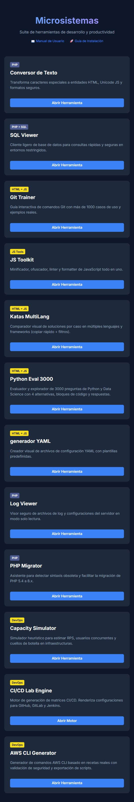
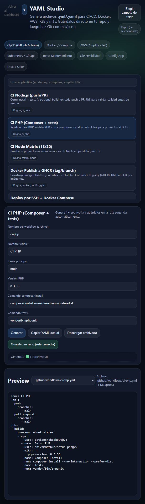
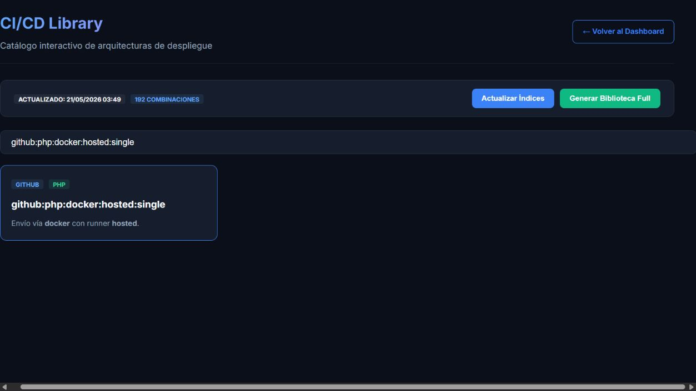
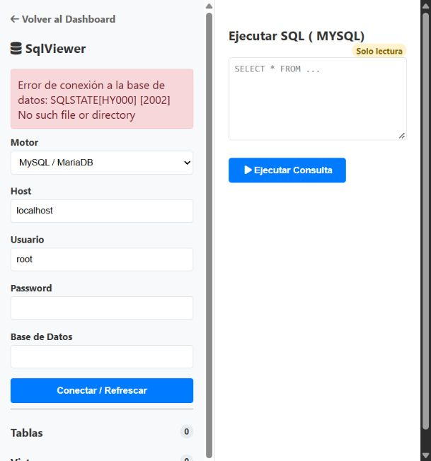
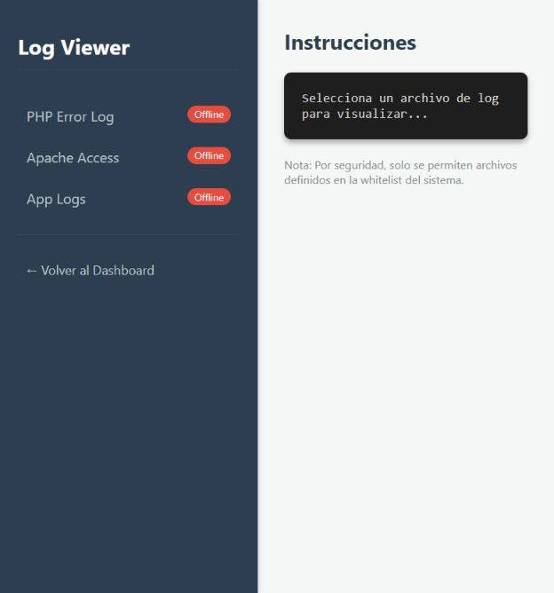
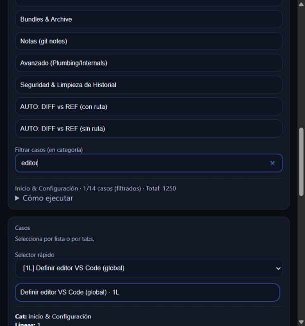
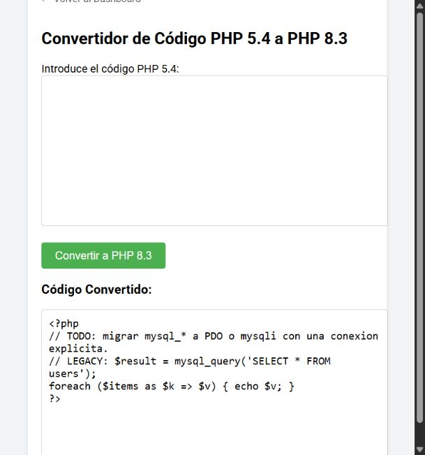
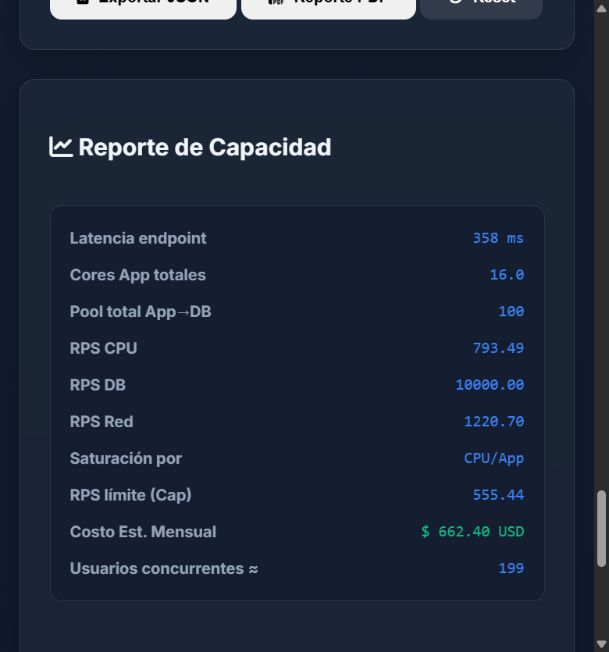
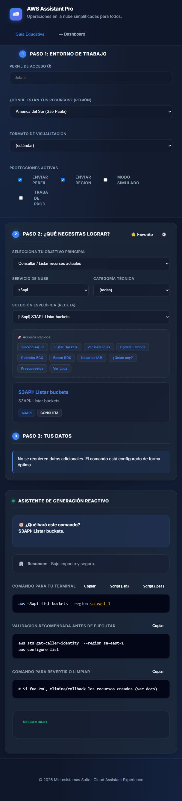
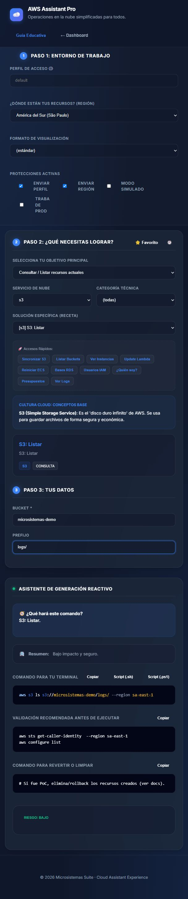

# Prueba funcional visual de Microsistemas

Fecha de ejecucion: **2026-10-27**.

## Alcance y entorno

Se recorrio la suite real desde el dashboard y se ejecuto una accion
representativa en cada una de sus 12 microaplicaciones. `localhost` fue solo la
direccion de servicio; el objeto probado fue **Microsistemas**, no una pagina de
diagnostico aislada.

- Navegador: navegador integrado de Codex, con interaccion de usuario real.
- URL de prueba: `http://127.0.0.1:18000/`.
- Runtime: imagen Docker construida por el repositorio con PHP `8.5.12`.
- Servidor: Apache no-root en el puerto interno `8080`, publicado solo en
  `127.0.0.1:18000` para la prueba.
- Seguridad adicional: `session.upload_progress.enabled=0`.
- Evidencia: capturas JPEG sin datos personales ni credenciales reales.

La version PHP usada contiene las correcciones para CVE-2026-109618 y
CVE-2026-109619. El detalle de exposicion, versiones minimas y remediacion esta
en [Actualizacion de seguridad PHP](PHP_SECURITY_2026-10.md).

## Resultado ejecutivo

| Estado | Cantidad | Alcance |
| :--- | ---: | :--- |
| PASS | 10 | Flujos funcionales con dependencias incluidas en la imagen |
| FAIL | 0 | Sin fallos reproducibles pendientes en los flujos revalidados |
| DEGRADADO | 2 | SQL Viewer y Log Viewer, por servicios o archivos no montados |

El dashboard tambien cargo correctamente y mostro las 12 aplicaciones. Un
estado `DEGRADADO` no se cuenta como fallo de la interfaz: indica que la
aplicacion manejo de forma visible la ausencia de una dependencia externa.

## Matriz de ejecucion

| Aplicacion | Accion ejecutada | Resultado | Evidencia |
| :--- | :--- | :---: | :--- |
| Dashboard | Apertura y verificacion de las 12 tarjetas | PASS | [00](evidence/full-suite-2026-10-27/00-dashboard.jpg) |
| Conversor | Transformar texto con HTML, ampersand y acentos | PASS | [01](evidence/full-suite-2026-10-27/01-conversor.jpg) |
| SQL Viewer | Abrir conexion sin MySQL disponible | DEGRADADO | [02](evidence/full-suite-2026-10-27/02-sqlviewer-degradado.jpg) |
| Git Trainer | Filtrar los casos por `editor` | PASS | [correccion](evidence/fixes-2026-10-27/01-gittrainer-corregido.jpg) |
| JS Toolkit | Formatear una funcion JavaScript | PASS | [04](evidence/full-suite-2026-10-27/04-jstools-formato.jpg) |
| Katas MultiLang | Buscar la kata `JWT` | PASS | [05](evidence/full-suite-2026-10-27/05-katas-jwt.jpg) |
| Python Eval 3000 | Responder correctamente una pregunta | PASS | [06](evidence/full-suite-2026-10-27/06-python-eval-respuesta.jpg) |
| YAML Studio | Generar CI PHP con PHP `8.3.36` | PASS | [07](evidence/full-suite-2026-10-27/07-yaml-generado.jpg) |
| Log Viewer | Abrir catalogo sin logs montados | DEGRADADO | [08](evidence/full-suite-2026-10-27/08-logviewer-sin-logs.jpg) |
| PHP Migrator | Migrar `mysql_query` y `each()` y validar la salida | PASS | [correccion](evidence/fixes-2026-10-27/02-phpmigrator-corregido.jpg) |
| CapacitySim | Pulsar `Calcular` con valores iniciales | PASS | [correccion](evidence/fixes-2026-10-27/03-capacitysim-corregido.jpg) |
| CI/CD Library | Filtrar una de 192 combinaciones | PASS | [11](evidence/full-suite-2026-10-27/11-cicdlibrary-filtro.jpg) |
| AWS Generator | Listar buckets y generar una ruta con bucket y prefijo | PASS | [buckets](evidence/fixes-2026-10-27/04-awsgenerator-buckets-corregido.jpg), [parametros](evidence/fixes-2026-10-27/05-awsgenerator-parametros-corregido.jpg) |

## Correcciones verificadas

### F-01: filtro de Git Trainer

El filtro ya no evalua texto descriptivo generico compartido por todos los
casos. Al escribir `editor`, la interfaz muestra un unico caso coincidente y el
contador visible cambia a `1/14 casos (filtrados)`.

### F-02: salida de PHP Migrator

El patron legado con `each()` se convierte en un `foreach` sintacticamente
valido. Las llamadas `mysql_*` no se renombran de forma insegura: quedan
comentadas con una tarea explicita para migrarlas a PDO o mysqli con una
conexion real. La salida fue comprobada ademas con `php -l`.

### F-03: calculo de CapacitySim

Se corrigieron todas las referencias obsoletas que quedaron tras renombrar
variables. La accion `Calcular` completa las metricas, identifica el cuello de
botella y dibuja el grafico sin `ReferenceError`.

### F-04: comandos de AWS Generator

La accion `Listar Buckets` selecciona ahora la receta S3API adecuada y genera
`aws s3api list-buckets --region sa-east-1`. Tambien se verifico que editar el
bucket y el prefijo actualiza de forma reactiva el comando S3. No se ejecuto
ningun comando contra una cuenta AWS.

## Estados degradados controlados

### SQL Viewer

La prueba aislada de la imagen web no adjunto un servicio MySQL. La aplicacion
no se cayo: presento un error de conexion comprensible. La instalacion Docker
Compose documentada incorpora el servicio `db` para validar este flujo con
credenciales locales no productivas.

### Log Viewer

No se montaron archivos de log del host. Las fuentes aparecieron como
`Offline`, con orientacion para su configuracion. No se expusieron rutas ni
datos sensibles.

## Accesibilidad basica y recuperacion

- Los controles principales se expusieron al navegador como botones, campos y
  selectores con nombres utilizables.
- El dashboard permitio navegacion inicial con teclado.
- Los parametros dinamicos de AWS Generator asocian sus etiquetas al campo.
- Los estados de error de SQL Viewer y Log Viewer fueron visibles y no
  bloquearon el regreso al dashboard.
- Esta revision es preliminar y no equivale a una auditoria WCAG completa.

## Evidencia visual

### Dashboard y flujos correctos

### Estados degradados

### Correcciones revalidadas

## Conclusion

La retirada de XAMPP no impide iniciar ni recorrer la suite. La imagen oficial
con PHP `8.5.12` sirve el dashboard y las 12 aplicaciones; los cuatro fallos
funcionales detectados en la primera pasada quedaron corregidos y revalidados.
SQL Viewer y Log Viewer conservan una ruta degradada controlada cuando sus
dependencias externas no estan montadas. La prueba no sustituye un pentest, una
auditoria WCAG completa ni una certificacion de produccion.
