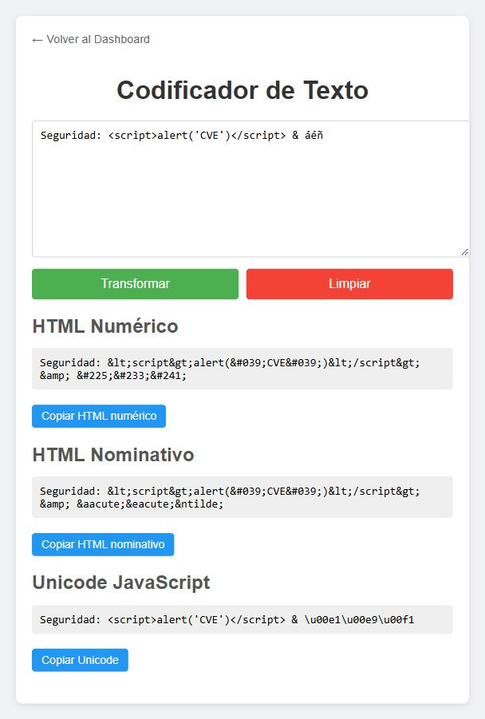
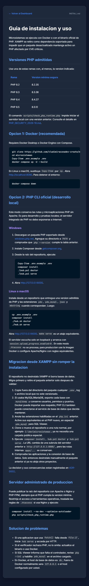

# Informe de pruebas funcionales: PHP CLI y remediacion CVE

- **Fecha:** 2026-10-27
- **Entorno:** Windows host + Docker Desktop; navegador integrado visible
- **Imagen probada:** `microsistemas:cve-2026-functional`
- **Servidor probado:** PHP CLI en `127.0.0.1:18000` (puerto de evidencia)

## Resultado ejecutivo

La suite conserva el dashboard, las rutas de microaplicaciones y el visor de
documentacion sin depender de XAMPP. El runtime seguro PHP 8.5.12 arranca y
responde; el PHP 8.2.12 heredado de XAMPP es rechazado antes de iniciar el
servidor.

Durante el recorrido se detecto que `.dockerignore` excluia `docs/` y
`README.md`, por lo que el enlace visible **Guia de Instalacion** fallaba dentro
de la imagen. Se corrigio la exclusion, se reconstruyo la imagen y se repitio el
flujo con resultado HTTP 200 y contenido visible.

## Casos ejecutados

| ID | Flujo | Evidencia observable | Resultado |
|---|---|---|---|
| F-01 | Abrir dashboard sin XAMPP | HTTP 200; 12 tarjetas visibles | Aprobado |
| F-02 | Abrir Conversor desde dashboard | Navegacion por enlace, no URL directa | Aprobado |
| F-03 | Transformar texto con HTML, ampersand y acentos | Tres salidas generadas; HTML escapado | Aprobado |
| F-04 | Abrir Guia de Instalacion | HTTP 200; tabla de versiones y migracion visibles | Aprobado tras correccion |
| F-05 | Health endpoint CapacitySim | HTTP 200 | Aprobado |
| F-06 | Abrir README mediante `doc.php` | HTTP 200 | Aprobado |
| F-07 | Teclado y nombres accesibles | `Tab` enfoca Manual de Usuario; controles tienen roles/nombres | Aprobado basico |
| D-01 | Intentar iniciar con PHP 8.2.12 de XAMPP | `check_php_runtime.php` y `hub.ps1 serve` salen con codigo 1 | Aprobado (bloqueo esperado) |
| R-01 | Iniciar con PHP 8.5.12 | Verificador OK; servidor disponible en loopback | Aprobado |

## Evidencia visual

### Dashboard completo

### Conversor con una transformacion real

### Guia de instalacion accesible desde la interfaz

## Controles tecnicos complementarios

- Imagen Docker construida correctamente desde `php:8.5.12-apache-bookworm`.
- PHP 8.5.12 aceptado por `scripts/check_php_runtime.php`.
- `bash hub.sh serve` iniciado dentro de la imagen y verificado con HTTP 200.
- `session.upload_progress.enabled=false` dentro del contenedor.
- 27 archivos PHP sin errores de sintaxis.
- 15 archivos JavaScript aceptados por `node --check`.
- `composer check-platform-reqs --no-dev`: correcto.
- `composer audit --no-dev`: sin avisos de vulnerabilidad de dependencias.
- 29 documentos modificados: cero errores con markdownlint-cli2 0.19.0.
- Endpoints `/`, `doc.php?file=INSTALL.md`, `doc.php?file=README.md`,
  `apps/Conversor/` y `apps/CapacitySim/health/`: HTTP 200.

## Alcance y limites

La prueba cubre funcionamiento local, ruta degradada, recuperacion y
accesibilidad basica. SQL Viewer no se conecto a una base real porque retirar
XAMPP separa deliberadamente el servidor PHP del servicio MySQL; la guia explica
como conservar o importar esa base y configurar `pdo_mysql`. Esto no sustituye
un pentest ni una certificacion de produccion.
