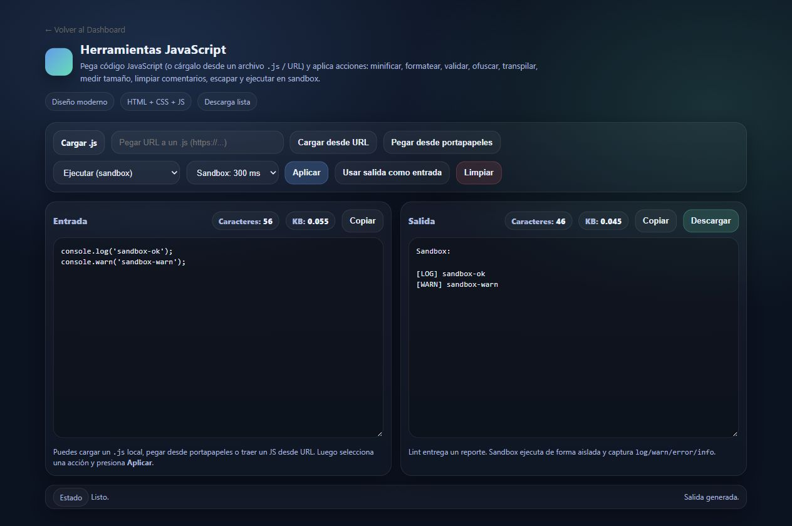
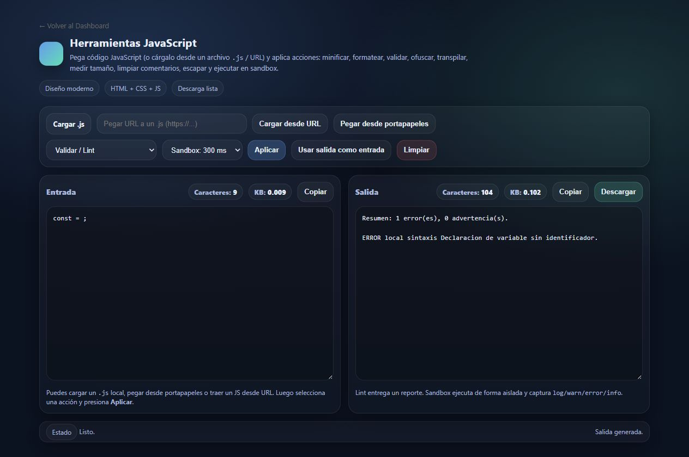
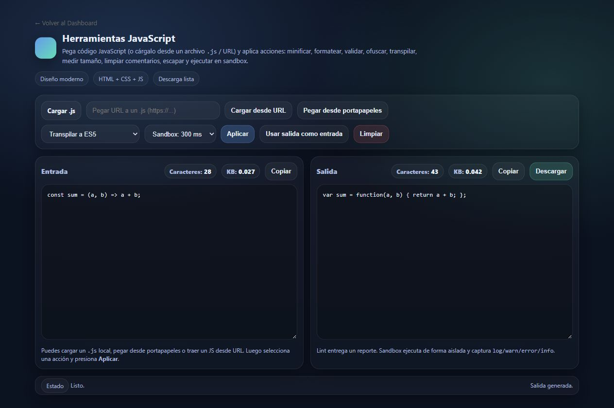

# Evidencia funcional - JsTools issue #1

Fecha: 27 de octubre de 2026

Entorno: Docker Desktop, imagen local `microsistemas:issue-1-20261027`

URL: `http://127.0.0.1:18000/apps/JsTools/`

## Runtime verificado

- Contenedor `microsistemas-resolved-20261027`: `running` y `healthy`.
- PHP: `8.5.12`.
- `session.upload_progress.enabled`: `0`.
- La ruta historica `/apps/JsTools/` abre la interfaz canonica
  `herramientas_javascript.html`.
- Consola del navegador: 0 errores y 0 advertencias de carga.

## Criterios de aceptacion

| Flujo | Entrada representativa | Resultado observado | Estado |
| :--- | :--- | :--- | :---: |
| Minificar | Comentario y declaracion | Comentario eliminado; codigo conservado | OK |
| Formatear | Funcion en una linea | Sangria y saltos de linea aplicados | OK |
| Lint | `const = ;` | Un error local de declaracion invalida | OK |
| Ofuscar | Declaracion con string | Payload codificado y wrapper ejecutable | OK |
| Transpilar | `const` y arrow function | `var` y funcion clasica | OK |
| Eliminar comentarios | Comentarios de linea y bloque | Comentarios eliminados | OK |
| Escapar JSON | Texto multilinea | Nueva linea escapada como `\\n` | OK |
| Des-escapar JSON | String JSON | Texto multilinea recuperado | OK |
| Analizar tamano | Codigo con comentario | Bytes originales, minificados y ahorro | OK |
| Sandbox - salida | `console.log` y `console.warn` | Captura `[LOG]` y `[WARN]` | OK |
| Sandbox - error | Excepcion no controlada | Captura `[ONERROR]` | OK |
| Descarga | Salida transpilada | `codigo.es5.js`, 43 bytes, contenido correcto | OK |

## Capturas

### Sandbox: logs y advertencias



### Lint: error observable



### Transpilacion ES5



## Regresion automatizada

```text
node --check apps/JsTools/hj.js
node tests/jstools_regression.js
OK: regresion JsTools (estructura y respaldos locales)
```

El workflow `CI Microsistemas` incorpora el job `test-jstools`, que repite
estas comprobaciones cuando cambia `apps/JsTools/`.
