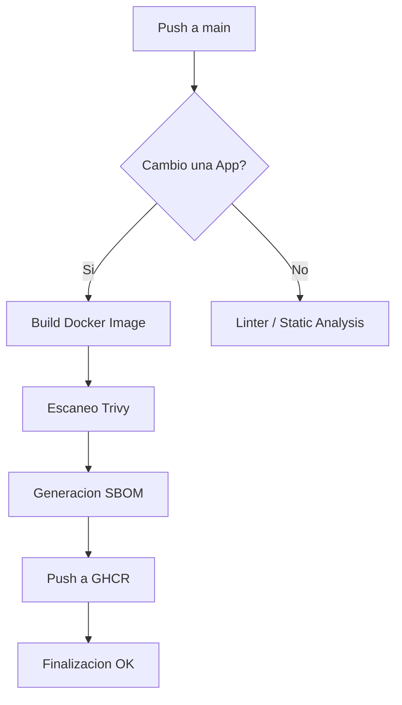

# Arquitectura - Microsistemas Suite

Este documento describe la estructura del proyecto, el flujo de datos y las decisiones de diseno que permiten que Microsistemas sea una suite robusta y modular.

## 🏗️ Estructura del Proyecto

El repositorio esta organizado como un **monorepo**, donde el "Core" gestiona los recursos compartidos y las "Apps" contienen la logica de negocio individual.

```text
/
├── apps/           # Todas las micro-herramientas (Modulos)
│   ├── AwsGenerator
│   └── ...
├── core/           # Clases base, Autoloading y Configuracion
├── docs/           # Guias tecnicas y manuales
├── scripts/        # Automatizacion de catalogo y revision
├── .github/        # Workflows (CI/CD, Security, Wiki)
└── Makefile        # Orquestador de comandos
```

### El Core (`core/`)

La logica compartida se organiza bajo el namespace `Microsistemas\`.

### 1. `Microsistemas\Core\Config`

Centraliza el acceso a la configuracion.

- Utiliza `vlucas/phpdotenv` para cargar archivos `.env`.
- Metodo `get($key, $default)` para recuperacion segura.

### 2. `Microsistemas\Core\Database`

Gestiona el ciclo de vida de la conexion MySQL.

- Implementa el patron **Singleton** para evitar multiples conexiones innecesarias.
- Inyecta automaticamente credenciales desde `Config`.

---

## 🚀 Flujo de CI/CD (GitHub Actions)

El ciclo de vida de cada cambio sigue este flujo automatizado:



1. **Linting**: Validacion de estandares PSR-12 para PHP y PEP8 para Python.
2. **Seguridad**: Escaneo de secretos (TruffleHog) y vulnerabilidades en dependencias (Trivy).
3. **Distribucion**: Publicacion automatica de imagenes en GitHub Container Registry (GHCR).

---

## 🐳 Capas del Contenedor (Dockerfile)

La imagen oficial se basa en `php:8.5.12-apache-bookworm`, corregida contra
CVE-2026-109618 y CVE-2026-109619:

1. **Base**: Debian Bookworm + Apache.
2. **Ext**: Instalacion de `mysqli`, `pdo_mysql` y `gd`.
3. **App**: Copia del codigo y limpieza de rutas.
4. **Security**: Configuracion de permisos `www-data`, deshabilitacion de
   navegacion por carpetas y progreso de carga de sesion deshabilitado.

---

## 🛠️ Estandares Utilizados

- **PSR-4**: Autoloading de clases.
- **12-Factor App**: Configuracion por variables de entorno.
- **Semantic Versioning (SemVer)**: Tags `v1.x.x` para el control de versiones.
